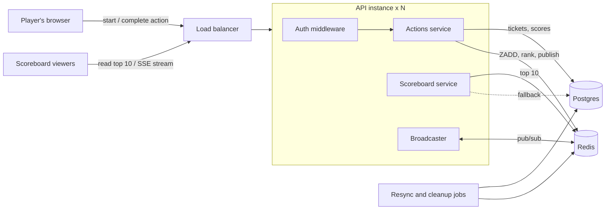
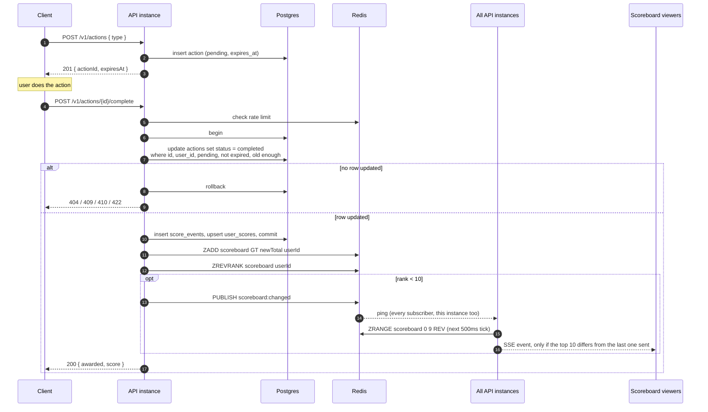

# Problem 6: Scoreboard module

Spec for the scoreboard module on the API server. It's written for the backend team that will build it.

The module has to:

1. Serve the top 10 user scores.
2. Push live updates to everyone watching the scoreboard.
3. Only add score for actions the server can vouch for, so users can't increase their score without authorisation.

## 1. Scope

In scope:

- the action ticket API that increases a user's score
- the scoreboard read API and the live update stream
- storage in Postgres and Redis, and how the two stay in sync

Out of scope:

- what the action actually is (the brief says we don't need to care)
- login and user management, which already exist
- the scoreboard UI

## 2. Assumptions

- Users already log in through the existing auth (JWT or session). This module gets `userId` from the existing auth middleware, never from the request body.
- Every action type is worth a fixed number of points, configured on the server.
- The action happens on the client, and the server can't check its result. If it can, see [Improvements](#13-improvements), because that changes the anti-cheat design.
- There are several API instances behind a load balancer, so live updates have to work across instances.
- Rough sizing for v1: up to ~50k open scoreboards and a few hundred score updates per second at peak.

## 3. Architecture



| Component          | Responsibility                                                                                              |
| ------------------ | ----------------------------------------------------------------------------------------------------------- |
| Auth middleware    | Existing. Rejects anonymous calls to the action endpoints and sets `userId`.                                |
| Actions service    | Issues tickets, completes them, awards points. The only code that writes scores.                            |
| Scoreboard service | Reads the top 10 from Redis, falls back to Postgres if Redis is unavailable.                                |
| Broadcaster        | Holds this instance's SSE connections, listens on Redis pub/sub, pushes the top 10 when it changes.         |
| Postgres           | Source of truth: tickets, the score ledger, and each user's total.                                          |
| Redis              | Fast top 10 (sorted set), cross-instance pub/sub, rate limit counters. Can always be rebuilt from Postgres. |
| Jobs               | Resync Redis from Postgres every minute. Delete old unfinished tickets daily.                               |

## 4. Anti-cheat design

The obvious design, `POST /scores { points }`, can be called in a loop from devtools. Requiring login doesn't fix that, because a logged-in user can still replay the request or change `points`.

So:

1. **The client never sends points.** The server looks up how many points an action type is worth.
2. **Every score increase needs a ticket the server issued.** Before the action, the client asks for a ticket: a random id, tied to the user and the action type, with an expiry.
3. **Completing a ticket is checked, not trusted.** The ticket must belong to the caller, still be pending, not be expired, and be at least `minDurationMs` old for its type, which catches scripts that "finish" instantly. Calls are rate limited per user and per IP.
4. **A ticket pays out once.** Completing it is a single conditional update, and the score ledger has a unique key on the ticket id.

What this can't do: if the action only happens in the browser, a determined user can still script the whole flow at human speed (get a ticket, wait, complete). This design limits them to that speed and leaves an audit trail that makes them easy to spot. Only checking the action on the server can stop it completely.

## 5. API

All endpoints are under `/v1`. The two action endpoints require auth. Reading the scoreboard is public.

### `POST /v1/actions`

Start an action and get a ticket.

```json
{ "type": "daily_quiz" }
```

`201`:

```json
{ "actionId": "4f1c2a9e-8f0b-4c7e-9a43-2b1d7d5e0c11", "expiresAt": "2026-10-15T10:15:00Z" }
```

`400` if `type` isn't a configured action type. `401` if not logged in. `429` if rate limited.

### `POST /v1/actions/{actionId}/complete`

Complete the ticket and get the points. No body.

`200`:

```json
{ "awarded": 10, "score": 1340 }
```

| Status | When                                                            |
| ------ | --------------------------------------------------------------- |
| `401`  | not logged in                                                   |
| `404`  | no such ticket, or it belongs to someone else (don't say which) |
| `409`  | already completed                                               |
| `410`  | expired                                                         |
| `422`  | completed faster than `minDurationMs` for its type              |
| `429`  | rate limited, with `Retry-After`                                |

Errors use the API's usual shape: `{ "error": { "code": "action_already_completed", "message": "..." } }`.

### `GET /v1/scoreboard`

```json
{
  "updatedAt": "2026-10-15T10:02:11Z",
  "entries": [{ "rank": 1, "userId": "u_812", "displayName": "minh", "score": 4210 }]
}
```

`displayName` comes from the existing users table.

### `GET /v1/scoreboard/stream`

Server-Sent Events. Sends the current top 10 as soon as the client connects, then again every time it changes. A comment line every 25s keeps proxies from closing the connection.

```
event: scoreboard
data: {"updatedAt":"2026-10-15T10:02:11Z","entries":[...]}
```

Every event is the full top 10 (about 1 KB), not a diff, so a client that missed events is correct again after the next one. Set `Cache-Control: no-cache`, and `X-Accel-Buffering: no` behind nginx.

SSE instead of WebSockets: updates only go one way, score changes already go through normal POSTs, and SSE is plain HTTP with reconnect built into the browser.

## 6. Data model

### Postgres

```sql
create table user_scores (
  user_id    text primary key,
  score      bigint not null default 0,
  updated_at timestamptz not null default now()
);
create index on user_scores (score desc);

create table actions (
  id           uuid primary key,
  user_id      text not null,
  type         text not null,
  status       text not null default 'pending',
  started_at   timestamptz not null default now(),
  expires_at   timestamptz not null,
  completed_at timestamptz
);
create index on actions (user_id, started_at);

create table score_events (
  id         bigserial primary key,
  user_id    text not null,
  action_id  uuid not null unique references actions (id),
  points     int not null,
  created_at timestamptz not null default now()
);
```

`score_events` is the audit log. The unique `action_id` means one ticket can never pay out twice, even with a bug in the service code.

### Redis

| Key                          | Type            | Holds                                     | Expiry |
| ---------------------------- | --------------- | ----------------------------------------- | ------ |
| `scoreboard`                 | sorted set      | member `userId`, score = the user's total | none   |
| `scoreboard:changed`         | pub/sub channel | a ping with no data                       | -      |
| `ratelimit:{scope}:{minute}` | counter         | requests this minute, per user or per IP  | 60s    |
| `scoreboard:rebuild`         | lock (`SET NX`) | held by the instance rebuilding the cache | 5s     |

Top 10 is `ZRANGE scoreboard 0 9 REV WITHSCORES`, then one lookup for the 10 display names.

## 7. Execution flow

1. The client starts an action. The API stores a `pending` ticket and returns its id.
2. The user does the action.
3. The client completes the ticket. The API checks the rate limit in Redis.
4. One conditional `UPDATE` claims the ticket. If no row comes back, the API reads the ticket once to choose 404, 409, 410 or 422.
5. In the same transaction, it inserts into `score_events` and upserts `user_scores`, which returns the new total. Then it commits.
6. After the commit, and only then, it writes the new total to Redis with `ZADD GT` and reads the user's rank.
7. If the user is now in the top 10, it publishes a ping on `scoreboard:changed`.
8. Every instance, on its next 500ms tick, reads the top 10 from Redis and pushes it to its SSE clients if it differs from what it last sent.
9. The client gets `200 { awarded, score }`.



### Implementation notes

- **Claiming the ticket:** `update actions set status = 'completed', completed_at = now() where id = $1 and user_id = $2 and status = 'pending' and expires_at > now() and started_at <= now() - $minDuration returning type`. If two requests race, only one gets a row back.
- **The score update is an upsert**, since a user's first action has no row yet: `insert into user_scores (user_id, score) values ($1, $2) on conflict (user_id) do update set score = user_scores.score + excluded.score, updated_at = now() returning score`.
- **`ZADD scoreboard GT <total> <userId>`, not `ZINCRBY`.** A retry can't add twice, and `GT` stops a slower request on another instance from overwriting a newer total with an older one.
- **Only publish if the user is in the top 10** after the update (`ZREVRANK` < 10). Someone dropping out of the top 10 always means someone else entered it, so that case is covered too.
- **The ping carries no data.** Because each instance reads the latest top 10 when it pushes, an old update can't arrive last and win.

## 8. Correctness

| Risk                                                   | What prevents it                                                           |
| ------------------------------------------------------ | -------------------------------------------------------------------------- |
| Two requests complete the same ticket at the same time | The conditional `UPDATE ... where status = 'pending'`: only one gets a row |
| A bug pays a ticket out twice                          | `unique (action_id)` on `score_events`                                     |
| Redis shows score from a transaction that rolled back  | Redis is written only after the commit                                     |
| Two instances write totals to Redis out of order       | `ZADD GT` with the absolute total                                          |
| A pub/sub ping is lost                                 | The resync job publishes a ping after every run                            |
| Redis loses data or restarts                           | The resync job rebuilds from Postgres; reads fall back to Postgres         |

## 9. Failure handling

- **Redis write fails after the Postgres commit:** the points are safe. The resync job puts the top 100 back into Redis every minute with plain `ZADD` (no `GT`), so it can also correct a score that's too high.
- **Redis is down:** `GET /v1/scoreboard` reads from Postgres (`order by score desc limit 10`, using the index). Live updates pause and come back with the next ping.
- **Redis is empty after a restart:** the first instance to notice takes the `scoreboard:rebuild` lock and reloads from Postgres. Other instances read Postgres directly until it's done, so they don't all rebuild at once.
- **An instance restarts:** its SSE clients reconnect to any instance and get a fresh top 10 straight away.
- **Tickets that are never completed:** a daily job deletes `pending` tickets that expired more than a day ago.

## 10. Security

| Attack                                          | What stops it                                                                                            |
| ----------------------------------------------- | -------------------------------------------------------------------------------------------------------- |
| Calling the action endpoints without logging in | Auth middleware on both endpoints                                                                        |
| Adding score to someone else's account          | `userId` only from auth, and the ticket must belong to the caller                                        |
| Sending a large number of points                | The client never sends points; the server decides from config                                            |
| Replaying a completed request                   | Tickets are single use; the ledger has a unique ticket id                                                |
| Guessing someone else's ticket id               | Random UUIDv4, and it only works for its owner                                                           |
| Scripting instant completions                   | `minDurationMs` per action type, plus rate limits                                                        |
| Scripting the real flow at human speed          | Can't be fully blocked without server-side checks; the audit log plus per-user award-rate alerts flag it |
| XSS through `displayName` on the public board   | The client renders it as text, never HTML                                                                |

Also: reject unknown fields in request bodies (especially `points` or `score`), and restrict CORS on the action endpoints to our own origins.

## 11. Configuration

| Setting            | Starting value                                      |
| ------------------ | --------------------------------------------------- |
| Action types       | e.g. `daily_quiz`: 10 points, `minDurationMs` 20000 |
| Ticket lifetime    | 15 minutes                                          |
| Rate limits        | 30/min per user per endpoint, 120/min per IP        |
| Broadcast interval | 500ms                                               |
| Scoreboard size    | 10                                                  |
| Resync             | every 60s, top 100                                  |

## 12. Acceptance tests

- Completing the same ticket twice in parallel gives one `200` and one `409`, and the score goes up once.
- Expired, too-fast, someone else's and unknown tickets return the codes in section 5.
- A request body with `points` is rejected.
- A score change handled by instance A reaches an SSE client connected to instance B.
- With Redis stopped, `GET /v1/scoreboard` still returns the top 10.

## 13. Improvements

- **Check the action on the server.** Ask product whether the action's result can be verified server-side (a quiz answer, a signed receipt, a game replay). If it can, that's much stronger than timing checks.
- **Ties.** Redis orders equal scores by member name. Product should pick a rule (usually first to reach the score wins).
- **An outbox table** instead of the resync job, to close the gap between the Postgres commit and the Redis write.
- **Daily or weekly boards**, as separate sorted sets fed from `score_events`.
- **App Attest / Play Integrity** tokens for mobile clients, which make scripting much harder.
- **Much bigger audiences:** past a few hundred thousand open connections, move fan-out to a dedicated realtime service.
